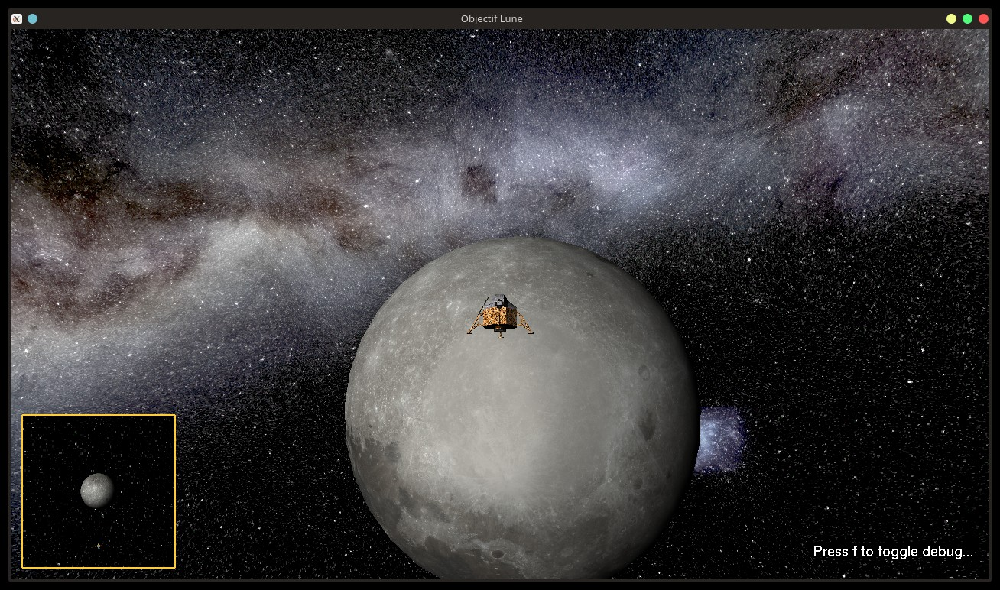
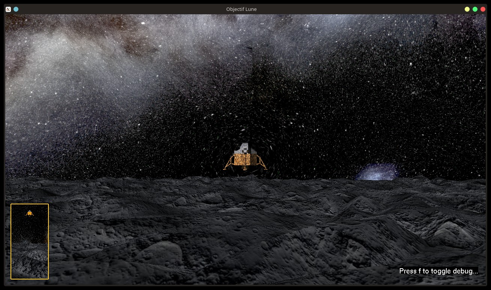
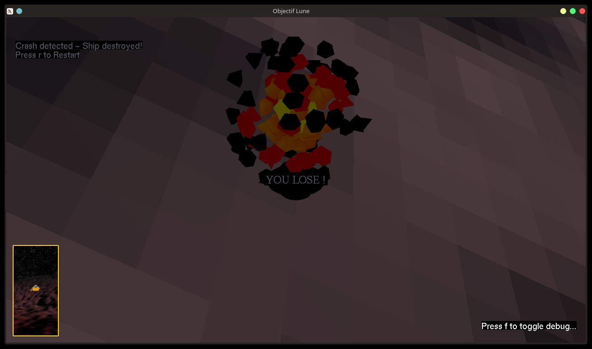
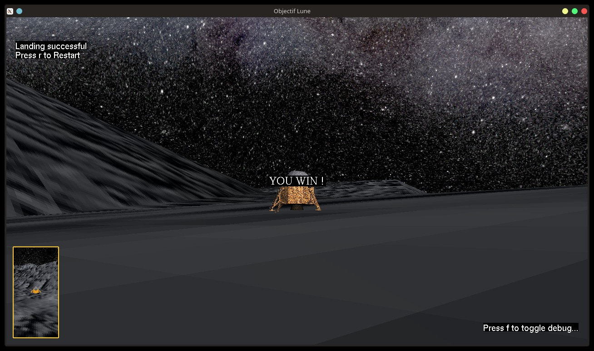
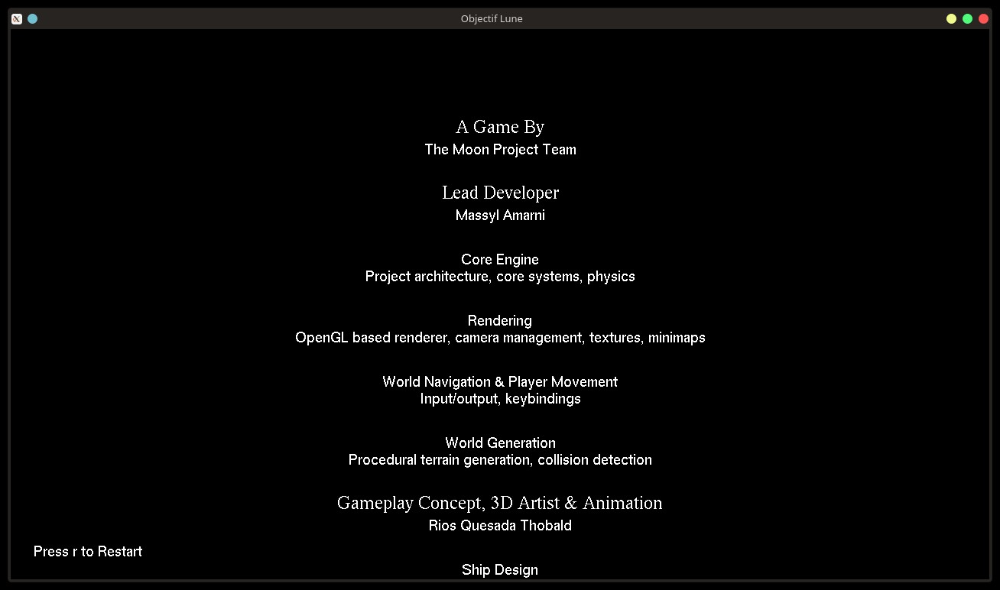
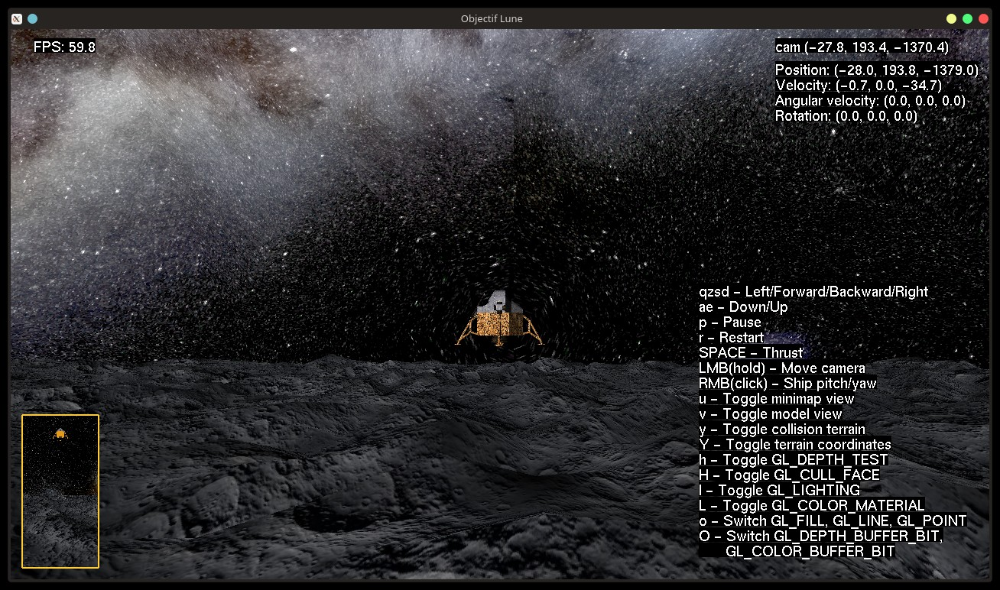
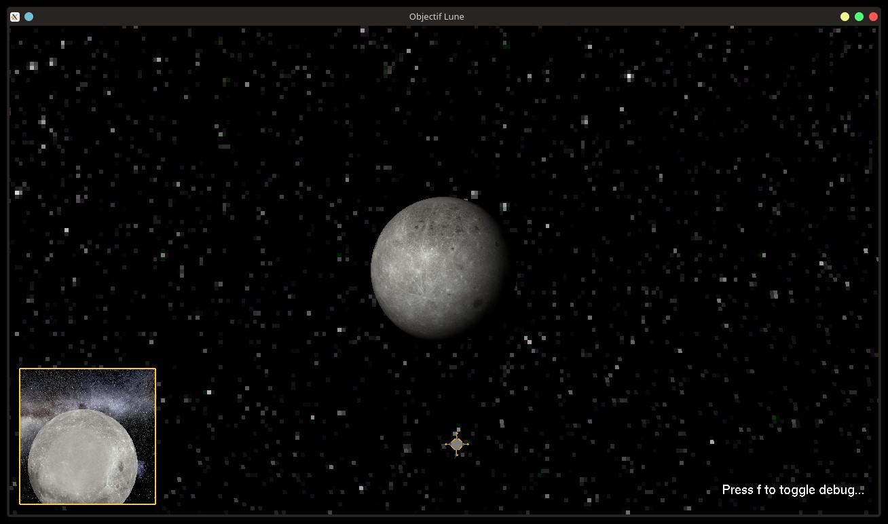
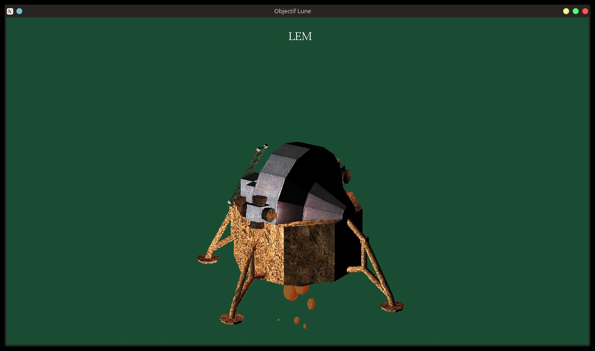
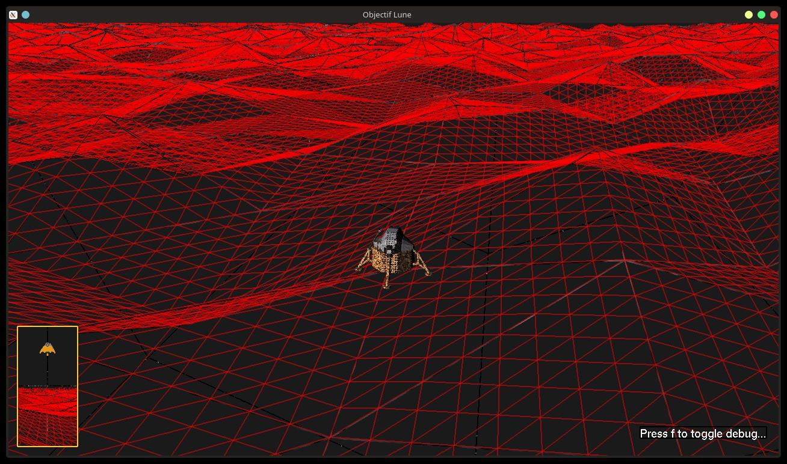

# Objectif Lune

A 3D lunar landing game built with OpenGL. Pilot a Lunar Excursion Module (LEM) from orbit down to the surface of a procedurally generated Moon, and touch down gently enough to survive.



## Features

- Physics-based flight: thrust, velocity, rotation and angular velocity
- Procedurally generated lunar terrain with collision detection
- Textured, animated LEM model with engine exhaust
- Skybox with a Milky Way backdrop
- Minimap view, free camera and a built-in model viewer
- Win / lose conditions with a crash explosion effect
- Debug overlay and OpenGL state toggles for experimenting with the renderer

## Screenshots

|               Descent               |              Crash              |
| :---------------------------------: | :-----------------------------: |
|  |  |

|                    Landing                     |               Credits               |
| :--------------------------------------------: | :---------------------------------: |
|  |  |

## Getting Started

### Prerequisites

- `g++` with C++17 support and `make`
- OpenGL, GLU and GLUT

On Debian/Ubuntu:

```sh
sudo apt install build-essential libgl1-mesa-dev libglu1-mesa-dev freeglut3-dev libpng-dev zlib1g-dev
```

### Build and run

From the project root:

```sh
make
./build/prog
```

## Controls

Default keybindings are designed for an **AZERTY** keyboard.

### Movement

| Key     | Action                     |
| ------- | -------------------------- |
| `z`     | Move along negative Z axis |
| `s`     | Move along positive Z axis |
| `q`     | Move along negative X axis |
| `d`     | Move along positive X axis |
| `a`     | Move along negative Y axis |
| `e`     | Move along positive Y axis |
| `SPACE` | Activate vertical thrust   |

### Camera and ship orientation

| Input         | Action          |
| ------------- | --------------- |
| `LMB` (hold)  | Move the camera |
| `RMB` (click) | Rotate the LEM  |
| Scroll        | Zoom            |

Right-click rotation depends on where you click in the window:

| Click position   | Effect         |
| ---------------- | -------------- |
| Left of window   | Yaw right      |
| Right of window  | Yaw left       |
| Top of window    | Pitch forward  |
| Bottom of window | Pitch backward |

### Simulation

| Key | Action  |
| --- | ------- |
| `p` | Pause   |
| `r` | Restart |

### View and debug

| Key | Action                     |
| --- | -------------------------- |
| `f` | Toggle debug display       |
| `u` | Toggle minimap             |
| `v` | Toggle model viewer        |
| `y` | Toggle collision terrain   |
| `Y` | Toggle terrain coordinates |









### OpenGL toggles

| Key | Action                                                        |
| --- | ------------------------------------------------------------- |
| `h` | Toggle `GL_DEPTH_TEST`                                        |
| `H` | Toggle `GL_CULL_FACE`                                         |
| `l` | Toggle `GL_LIGHTING`                                          |
| `L` | Toggle `GL_COLOR_MATERIAL`                                    |
| `o` | Cycle polygon mode: `GL_FILL`, `GL_LINE`, `GL_POINT`          |
| `O` | Cycle clear buffer: `COLOR+DEPTH`, `DEPTH only`, `COLOR only` |

## Gameplay

Descend toward the Moon and land the LEM on the surface.

- **Win**: land softly and upright. You see "Landing successful".
- **Lose**: hit the terrain too fast or at a bad angle. The ship is destroyed.

Press `r` at any time to restart. Enable the debug display with `f` to read your position, velocity and rotation while you fly.

## Project Structure

```
.
├── Makefile
├── src/                # Game source code (C++17)
├── assets/
│   └── models/         # LEM, explosion and color palette models
├── libs/
│   ├── PNG/            # PNG loading helpers
│   └── libpng12/       # Bundled libpng
└── build/              # Build output (created by make)
```
